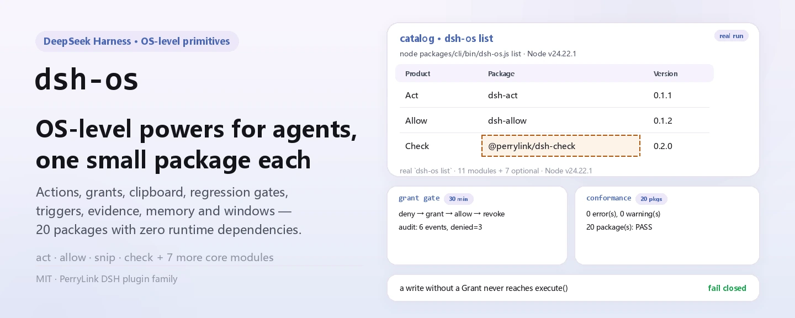
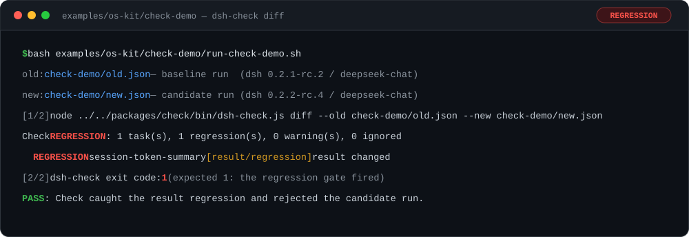
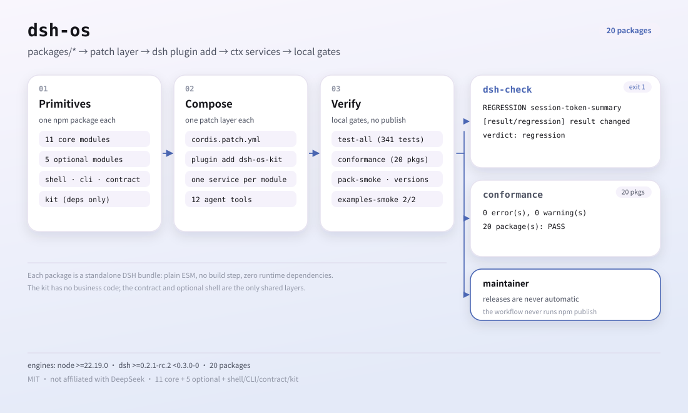
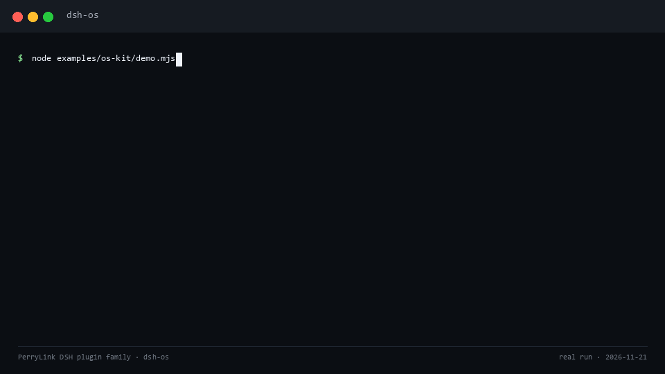

<div align="center">

<picture>
  <source media="(prefers-color-scheme: dark)" srcset="docs/assets/dsh-os-hero-en-dark.webp">
  
</picture>

# dsh-os

**Primitivas de nivel de SO para DeepSeek Harness — veinte paquetes pequeños que se mantienen independientes.**

*11 módulos centrales + 5 opcionales + un contrato, un shell de React, una CLI de catálogo y un kit de solo dependencias; un servicio Host por módulo, cero dependencias en tiempo de ejecución, y una escritura que nunca se ejecuta sin un Grant humano.*

[English](README.md) · [简体中文](README-zh.md) · [Español](README-es.md) · [Português](README-pt.md) · [हिन्दी](README-hi.md)

[](LICENSE)
[]()

</div>

---

Una familia de **primitivas de nivel de SO para DeepSeek Harness**: 11 módulos
centrales (Act, Allow, Snip, Check, Nest, Trigger, Seek, Trace, Stage, Ring, Root), 5
módulos opcionales (Help, Context, Cost, Backup, Notify), más un contrato delgado,
un shell de UI opcional, una CLI de catálogo y un kit de solo dependencias.

Los módulos se mantienen pequeños e independientes: un servicio Host, ≤6
herramientas de agente, cero dependencias en tiempo de ejecución, semver
independiente, sin importaciones entre módulos. El contrato
(`@perrylink/dsh-os-contract`) y el shell opcional son las únicas capas
compartidas; el kit no contiene código de negocio.

> **Sin afiliación con DeepSeek.** DeepSeek y DeepSeek Harness son marcas de
> sus respectivos propietarios. Estos son paquetes comunitarios independientes,
> publicados bajo MIT.

[](examples/os-kit/README.md)

**Ejecutable en 10 minutos:** [`examples/os-kit`](examples/os-kit/README.md)
tiene dos demos sin dependencias — Allow + Act + Snip (denegar → Grant de 30
minutos → permitir → revocar → denegar) y la puerta de regresión de Check.
`node examples/os-kit/demo.mjs` solo necesita Node 22+; no se instala ni se
publica nada.

**Documentación:** [Inicio rápido](docs/quickstart.md) ·
[Plan de validación](docs/validation/PLAN.md) ·
[Smoke de 0.2.0](docs/validation/SMOKE.md) ·
[Recetas](docs/recipes/) (puerta de CI, escrituras de agentes, portapapeles) ·
[Solución de problemas](docs/troubleshooting.md).

## Paquetes

| Producto | Paquete | Estado | Diseño |
|---|---|---|---|
| **Act** | `dsh-act` | 0.1.1 MVP | [diseño](docs/design/01-act.md) |
| **Allow** | `dsh-allow` | 0.1.2 MVP (endurecimiento de seguridad) | [diseño](docs/design/02-allow.md) |
| **Snip** | `dsh-snip` | 0.2.0 (captura Win/mac/Linux) | [diseño](docs/design/03-snip.md) |
| **Check** | `@perrylink/dsh-check` | 0.2.0 (runner headless + diff) | [diseño](docs/design/04-check.md) |
| **Nest** | `dsh-nest` | 0.1.0 MVP | [diseño](docs/design/05-nest.md) |
| **Trigger** | `dsh-trigger` | 0.2.0 (fuentes agent/fs/webhook) | [diseño](docs/design/06-trigger.md) |
| **Seek** | `dsh-seek` | 0.2.0 (proveedores locator + memento) | [diseño](docs/design/07-seek.md) |
| **Trace** | `@perrylink/dsh-trace` | 0.2.0 (adaptador memento) | [diseño](docs/design/08-trace.md) |
| **Stage** | `dsh-stage` | 0.2.0 (adaptadores macOS/Windows) | [diseño](docs/design/09-stage.md) |
| **Ring** | `dsh-ring` | 0.2.0 (webhook/ntfy/console) | [diseño](docs/design/10-ring.md) |
| **Root** | `@perrylink/dsh-root` | 0.1.2 MVP | [diseño](docs/design/11-root.md) |
| **Help** | `dsh-help` | 0.1.0 opcional | diagnóstico de instalación / primera ejecución |
| **Context** | `@perrylink/dsh-context` | 0.1.0 opcional | protocolo de proveedor de contexto |
| **Cost** | `@perrylink/dsh-cost` | 0.1.0 opcional | adaptador para `dsh-cost-meter` |
| **Backup** | `@perrylink/dsh-backup` | 0.1.0 opcional | manifiesto de snapshot / plan de restauración |
| **Notify** | `@perrylink/dsh-notify` | 0.1.0 opcional | registro de canales / enrutador de atención |
| **Shell** | `@perrylink/dsh-os-shell` | 0.2.0 opcional | cliente React (pestañas Act/Snip/Check) |
| **CLI** | `@perrylink/dsh-os-cli` | 0.1.0 herramienta | `dsh-os list/doctor/install` |
| **Contract** | `@perrylink/dsh-os-contract` | 0.1.0 biblioteca | constantes, refs, validación de manifest/tool |
| **Kit** | `dsh-os-kit` | 0.2.0 meta bundle | instala Act + Allow + Snip + Check 0.2.0 |

`Check`, `Trace`, `Root`, `Context`, `Cost`, `Backup`, `Notify`, `Shell`, `CLI`
y `Contract` usan el scope `@perrylink/` donde las reglas de similitud de nombres
de npm lo exigen; los nombres de producto se mantienen sin scope.

<picture>
  <source media="(prefers-color-scheme: dark)" srcset="docs/assets/dsh-os-flow-v5-dark.svg">
  
</picture>

*Estructura: paquete → capa de parche → servicio → puerta; `dsh-os-kit` instala Act + Allow + Snip + Check con un solo comando, y las mismas puertas se ejecutan en CI y en local. Las etiquetas de token dentro del diagrama son los nombres reales de paquetes, servicios y comandos, así que la misma imagen sirve para los cinco idiomas.*

## Instalación

```sh
# one-shot: the four core modules
dsh plugin --profile web add dsh-os-kit

# or individually
dsh plugin --profile web add dsh-act
dsh plugin --profile web add dsh-allow
dsh plugin --profile web add dsh-snip
dsh plugin --profile web add dsh-nest
dsh plugin --profile web add dsh-trigger
dsh plugin --profile web add dsh-seek
dsh plugin --profile web add dsh-stage
dsh plugin --profile web add dsh-ring
dsh plugin --profile web add @perrylink/dsh-check
dsh plugin --profile web add @perrylink/dsh-root
dsh plugin --profile web add @perrylink/dsh-trace

# optional small modules
dsh plugin --profile web add dsh-help
dsh plugin --profile web add @perrylink/dsh-context
dsh plugin --profile web add @perrylink/dsh-cost
dsh plugin --profile web add @perrylink/dsh-backup
dsh plugin --profile web add @perrylink/dsh-notify
dsh plugin --profile web add @perrylink/dsh-os-shell

# catalog CLI (no network, prints install plans)
npm i -g @perrylink/dsh-os-cli
dsh-os list
dsh-os doctor
```

## Estructura del repositorio

```
packages/    one npm package per primitive
examples/    dependency-free runnable demos
docs/        design notes and the implementation contract
scripts/     scaffold, test and publish helpers
```

## Estado

Veinte paquetes publican un MVP 0.1.x/0.2.x: servicios, herramientas de agente,
pruebas y un manifiesto de bundle (bibliotecas/CLI cuando aplica). 0.2.0 añade
los primeros adaptadores reales: runner headless de Check, captura de
portapapeles de Snip, fuentes agent/fs/webhook de Trigger, proveedores
locator/memento de Seek, ventanas macOS/Windows de Stage, adaptador memento de
Trace, canales webhook/ntfy/console de Ring y el shell de React.
`node scripts/test-all.mjs` ejecuta 21 suites; `npm run verify` ejecuta la
verificación completa de cuatro puertas de publicación.

## Desarrollo



*Animado: la salida real (stdout) de `node examples/os-kit/demo.mjs`, `bash examples/os-kit/check-demo/run-check-demo.sh` y `node scripts/conformance.mjs` el 2026-11-21 (líneas seleccionadas; los ids de Grant y los handles `clipboard://` cambian en cada ejecución). No se instala nada y no se usa la red.*

```sh
node scripts/scaffold.mjs
node scripts/test-all.mjs
node scripts/publish.mjs act allow   # requires NPM_TOKEN
```

## CI y publicación

CI (`.github/workflows/ci.yml`) se ejecuta en una matriz de Node 22 + 24 con la
caché de npm habilitada, y ejecuta cuatro puertas en orden:

```sh
node scripts/test-all.mjs
node scripts/conformance.mjs
node scripts/pack-smoke.mjs
node scripts/check-versions.mjs
```

- `pack-smoke` ejecuta `npm pack --dry-run --json` para cada `packages/*` y
  falla si al tarball le falta `package.json`, `index.js`, `cordis.patch.yml`,
  `README.md` o `LICENSE`.
- `check-versions` falla ante un `version` inválido, un rango `engines.dsh`
  sin límite superior, un `publishConfig.registry` que no sea npmjs, o
  `dependencies` no vacío.

La misma secuencia, incluidas las pruebas de los paquetes, se ejecuta en local
como `npm run verify`.

Las publicaciones **nunca son automáticas**. `.github/workflows/release.yml`
solo admite `workflow_dispatch`: toma una entrada `package` separada por comas
(nombres de directorio como `act,allow` o nombres npm como `dsh-act`), ejecuta
las mismas puertas en Node 24, luego hace `npm pack` solo de los paquetes
seleccionados y sube los tarballs como artefacto de compilación. Publicar es un
paso manual del mantenedor: requiere el secreto de repositorio `NPM_TOKEN` (un
token granular de npm autorizado a publicar `dsh-*` y `@perrylink/*`), un
entorno protegido por aprobación, y un `npm publish` explícito de los tarballs
revisados. El workflow nunca ejecuta `npm publish`.

## Comunidad, RFC y comentarios

- **Notas de lanzamiento y soporte:** [docs/community/launch.md](docs/community/launch.md)
  — lo que funciona hoy, lo que sigue siendo 0.3.0, y los borradores del post
  oficial / del envío a directorios.
- **RFC upstream (sugerencias, no requisitos):**
  [`ctx.actions`](docs/rfcs/ctx-actions.md),
  [`ctx.grant`](docs/rfcs/ctx-grant.md),
  [`ctx.triggers`](docs/rfcs/ctx-triggers.md).
- **Telemetría:** [docs/telemetry.md](docs/telemetry.md) — desactivada por
  defecto; 0.1.x no incluye código de telemetría ni de red.
- **Contribuir:** [CONTRIBUTING.md](CONTRIBUTING.md),
  [plantillas de issue](.github/ISSUE_TEMPLATE/) y la
  [plantilla de pull request](.github/PULL_REQUEST_TEMPLATE.md).
- **Sin afiliación con DeepSeek.** DeepSeek y DeepSeek Harness son marcas de
  sus respectivos propietarios.

## Licencia

MIT.
