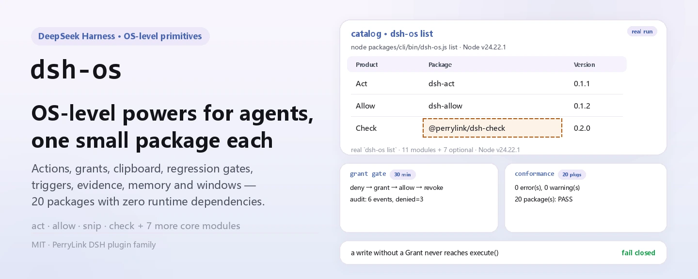
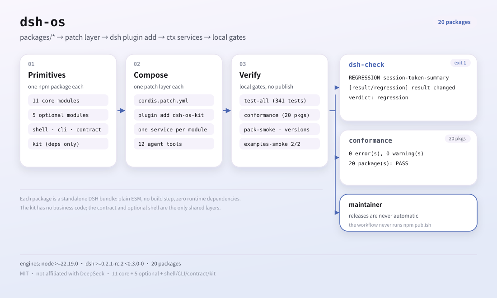
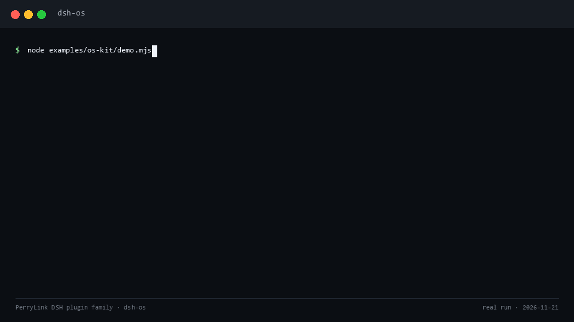

<div align="center">

<picture>
  <source media="(prefers-color-scheme: dark)" srcset="docs/assets/dsh-os-hero-en-dark.webp">
  
</picture>

# dsh-os

**DeepSeek Harness के लिए OS-स्तरीय प्रिमिटिव — बीस छोटे पैकेज जो स्वतंत्र रहते हैं।**

*11 कोर मॉड्यूल + 5 वैकल्पिक + एक पतला कॉन्ट्रैक्ट, एक React शेल, एक कैटलॉग CLI और सिर्फ़ डिपेंडेंसी वाला kit; प्रत्येक मॉड्यूल के लिए एक Host सेवा, शून्य रनटाइम डिपेंडेंसी, और एक ऐसी राइट जो मानव Grant के बिना कभी नहीं चलती।*

[English](README.md) · [简体中文](README-zh.md) · [Español](README-es.md) · [Português](README-pt.md) · [हिन्दी](README-hi.md)

[](LICENSE)
[]()

</div>

---

**DeepSeek Harness के लिए OS-स्तरीय प्रिमिटिव** का एक परिवार: 11 कोर मॉड्यूल
(Act, Allow, Snip, Check, Nest, Trigger, Seek, Trace, Stage, Ring, Root), 5
वैकल्पिक मॉड्यूल (Help, Context, Cost, Backup, Notify), साथ में एक पतला
कॉन्ट्रैक्ट, एक वैकल्पिक UI शेल, एक कैटलॉग CLI और सिर्फ़ डिपेंडेंसी वाला kit।

मॉड्यूल छोटे और स्वतंत्र रहते हैं: एक Host सेवा, ≤6 एजेंट टूल, शून्य
रनटाइम डिपेंडेंसी, स्वतंत्र semver, मॉड्यूल के बीच कोई इम्पोर्ट नहीं।
कॉन्ट्रैक्ट (`@perrylink/dsh-os-contract`) और वैकल्पिक शेल ही एकमात्र साझा
परतें हैं; kit में कोई बिज़नेस कोड नहीं है।

> **DeepSeek से कोई संबद्धता नहीं।** DeepSeek और DeepSeek Harness अपने-अपने
> स्वामियों के ट्रेडमार्क हैं। ये स्वतंत्र कम्युनिटी पैकेज हैं, MIT के अंतर्गत
> प्रकाशित।

[](examples/os-kit/README.md)

**10 मिनट में चलाएँ:** [`examples/os-kit`](examples/os-kit/README.md) में दो
बिना-डिपेंडेंसी डेमो हैं — Allow + Act + Snip (मना → 30 मिनट का Grant →
अनुमति → रद्द → मना) और Check रिग्रेशन गेट। `node examples/os-kit/demo.mjs`
को केवल Node 22+ चाहिए; कुछ भी इंस्टॉल या प्रकाशित नहीं होता।

**दस्तावेज़:** [क्विकस्टार्ट](docs/quickstart.md) ·
[वैलिडेशन प्लान](docs/validation/PLAN.md) ·
[0.2.0 स्मोक](docs/validation/SMOKE.md) ·
[रेसिपी](docs/recipes/) (CI गेट, एजेंट राइट, क्लिपबोर्ड) ·
[समस्या-समाधान](docs/troubleshooting.md)।

## पैकेज

| उत्पाद | पैकेज | स्थिति | डिज़ाइन |
|---|---|---|---|
| **Act** | `dsh-act` | 0.1.1 MVP | [डिज़ाइन](docs/design/01-act.md) |
| **Allow** | `dsh-allow` | 0.1.2 MVP (सुरक्षा सख़्ती) | [डिज़ाइन](docs/design/02-allow.md) |
| **Snip** | `dsh-snip` | 0.2.0 (Win/mac/Linux कैप्चर) | [डिज़ाइन](docs/design/03-snip.md) |
| **Check** | `@perrylink/dsh-check` | 0.2.0 (हेडलेस रनर + diff) | [डिज़ाइन](docs/design/04-check.md) |
| **Nest** | `dsh-nest` | 0.1.0 MVP | [डिज़ाइन](docs/design/05-nest.md) |
| **Trigger** | `dsh-trigger` | 0.2.0 (agent/fs/webhook स्रोत) | [डिज़ाइन](docs/design/06-trigger.md) |
| **Seek** | `dsh-seek` | 0.2.0 (locator + memento प्रदाता) | [डिज़ाइन](docs/design/07-seek.md) |
| **Trace** | `@perrylink/dsh-trace` | 0.2.0 (memento अडैप्टर) | [डिज़ाइन](docs/design/08-trace.md) |
| **Stage** | `dsh-stage` | 0.2.0 (macOS/Windows अडैप्टर) | [डिज़ाइन](docs/design/09-stage.md) |
| **Ring** | `dsh-ring` | 0.2.0 (webhook/ntfy/console) | [डिज़ाइन](docs/design/10-ring.md) |
| **Root** | `@perrylink/dsh-root` | 0.1.2 MVP | [डिज़ाइन](docs/design/11-root.md) |
| **Help** | `dsh-help` | 0.1.0 वैकल्पिक | इंस्टॉल डॉक्टर / पहला रन |
| **Context** | `@perrylink/dsh-context` | 0.1.0 वैकल्पिक | कॉन्टेक्स्ट प्रदाता प्रोटोकॉल |
| **Cost** | `@perrylink/dsh-cost` | 0.1.0 वैकल्पिक | `dsh-cost-meter` के लिए अडैप्टर |
| **Backup** | `@perrylink/dsh-backup` | 0.1.0 वैकल्पिक | स्नैपशॉट मैनिफ़ेस्ट / रिस्टोर प्लान |
| **Notify** | `@perrylink/dsh-notify` | 0.1.0 वैकल्पिक | चैनल रजिस्ट्री / अटेंशन राउटर |
| **Shell** | `@perrylink/dsh-os-shell` | 0.2.0 वैकल्पिक | React क्लाइंट (Act/Snip/Check टैब) |
| **CLI** | `@perrylink/dsh-os-cli` | 0.1.0 टूल | `dsh-os list/doctor/install` |
| **Contract** | `@perrylink/dsh-os-contract` | 0.1.0 लाइब्रेरी | कॉन्स्टेंट, refs, manifest/tool वैलिडेशन |
| **Kit** | `dsh-os-kit` | 0.2.0 मेटा बंडल | Act + Allow + Snip + Check 0.2.0 इंस्टॉल करता है |

`Check`, `Trace`, `Root`, `Context`, `Cost`, `Backup`, `Notify`, `Shell`, `CLI`
और `Contract` वहाँ `@perrylink/` scope इस्तेमाल करते हैं जहाँ npm के
नाम-समानता नियम माँगते हैं; उत्पाद के नाम बिना scope के रहते हैं।

<picture>
  <source media="(prefers-color-scheme: dark)" srcset="docs/assets/dsh-os-flow-v5-dark.svg">
  
</picture>

*संरचना: पैकेज → पैच परत → सेवा → गेट; `dsh-os-kit` एक ही कमांड में Act + Allow + Snip + Check इंस्टॉल करता है, और वही गेट CI और स्थानीय रूप से चलते हैं। आरेख के टोकन लेबल असली पैकेज, सेवा और कमांड नाम हैं, इसलिए एक ही चित्र पाँचों भाषाओं के लिए काम करता है।*

## इंस्टॉल

```sh
# one-shot: the four core modules
dsh plugin --profile web add dsh-os-kit

# or individually
dsh plugin --profile web add dsh-act
dsh plugin --profile web add dsh-allow
dsh plugin --profile web add dsh-snip
dsh plugin --profile web add dsh-nest
dsh plugin --profile web add dsh-trigger
dsh plugin --profile web add dsh-seek
dsh plugin --profile web add dsh-stage
dsh plugin --profile web add dsh-ring
dsh plugin --profile web add @perrylink/dsh-check
dsh plugin --profile web add @perrylink/dsh-root
dsh plugin --profile web add @perrylink/dsh-trace

# optional small modules
dsh plugin --profile web add dsh-help
dsh plugin --profile web add @perrylink/dsh-context
dsh plugin --profile web add @perrylink/dsh-cost
dsh plugin --profile web add @perrylink/dsh-backup
dsh plugin --profile web add @perrylink/dsh-notify
dsh plugin --profile web add @perrylink/dsh-os-shell

# catalog CLI (no network, prints install plans)
npm i -g @perrylink/dsh-os-cli
dsh-os list
dsh-os doctor
```

## रिपॉज़िटरी लेआउट

```
packages/    one npm package per primitive
examples/    dependency-free runnable demos
docs/        design notes and the implementation contract
scripts/     scaffold, test and publish helpers
```

## स्थिति

बीस पैकेज 0.1.x/0.2.x MVP भेजते हैं: सेवाएँ, एजेंट टूल, टेस्ट और एक bundle
manifest (जहाँ लागू हो वहाँ लाइब्रेरी/CLI)। 0.2.0 पहले असली अडैप्टर जोड़ता
है: Check हेडलेस रनर, Snip क्लिपबोर्ड कैप्चर, Trigger agent/fs/webhook स्रोत,
Seek locator/memento प्रदाता, Stage macOS/Windows विंडो, Trace memento
अडैप्टर, Ring webhook/ntfy/console चैनल और React शेल।
`node scripts/test-all.mjs` 21 सूट चलाता है; `npm run verify` पूरा चार-गेट
रिलीज़ चेक चलाता है।

## डेवलपमेंट



*एनिमेटेड: 2026-11-21 को `node examples/os-kit/demo.mjs`, `bash examples/os-kit/check-demo/run-check-demo.sh` और `node scripts/conformance.mjs` का असली stdout (चुनी हुई पंक्तियाँ; Grant id और `clipboard://` हैंडल हर रन में बदलते हैं)। कुछ भी इंस्टॉल नहीं होता और नेटवर्क इस्तेमाल नहीं होता।*

```sh
node scripts/scaffold.mjs
node scripts/test-all.mjs
node scripts/publish.mjs act allow   # requires NPM_TOKEN
```

## CI और रिलीज़

CI (`.github/workflows/ci.yml`) npm कैश सक्षम करके Node 22 + 24 मैट्रिक्स पर
चलता है, और चार गेट क्रम से निष्पादित करता है:

```sh
node scripts/test-all.mjs
node scripts/conformance.mjs
node scripts/pack-smoke.mjs
node scripts/check-versions.mjs
```

- `pack-smoke` हर `packages/*` के लिए `npm pack --dry-run --json` चलाता है और
  तब विफल होता है जब tarball में `package.json`, `index.js`, `cordis.patch.yml`,
  `README.md` या `LICENSE` न हो।
- `check-versions` अमान्य `version`, ऊपरी सीमा के बिना `engines.dsh` रेंज,
  npmjs के अलावा `publishConfig.registry`, या ग़ैर-ख़ाली `dependencies` पर
  विफल होता है।

वही क्रम, पैकेज टेस्ट सहित, स्थानीय रूप से `npm run verify` के रूप में चलता है।

रिलीज़ **कभी स्वतः प्रकाशित नहीं होते**। `.github/workflows/release.yml`
केवल `workflow_dispatch` है: यह कॉमा से अलग किया गया `package` इनपुट लेता है
(डायरेक्टरी नाम जैसे `act,allow` या npm नाम जैसे `dsh-act`), Node 24 पर वही
गेट चलाता है, फिर केवल चुने हुए पैकेजों का `npm pack` करता है और tarball को
बिल्ड आर्टिफ़ैक्ट के रूप में अपलोड करता है। प्रकाशन एक मैनुअल मेंटेनर कदम है:
इसके लिए `NPM_TOKEN` रिपॉज़िटरी सीक्रेट (एक ग्रैन्युलर npm टोकन जिसे `dsh-*`
और `@perrylink/*` प्रकाशित करने की अनुमति है), एक अनुमोदन-संरक्षित एनवायरनमेंट,
और समीक्षित tarballs का स्पष्ट `npm publish` चाहिए। वर्कफ़्लो कभी `npm publish`
नहीं चलाता।

## समुदाय, RFC और फ़ीडबैक

- **लॉन्च और सहायता नोट्स:** [docs/community/launch.md](docs/community/launch.md)
  — आज क्या काम करता है, क्या अभी 0.3.0 है, और आधिकारिक पोस्ट / डायरेक्टरी
  सबमिशन के ड्राफ़्ट।
- **अपस्ट्रीम RFC (सुझाव, अनिवार्यताएँ नहीं):**
  [`ctx.actions`](docs/rfcs/ctx-actions.md),
  [`ctx.grant`](docs/rfcs/ctx-grant.md),
  [`ctx.triggers`](docs/rfcs/ctx-triggers.md)।
- **टेलीमेट्री:** [docs/telemetry.md](docs/telemetry.md) — डिफ़ॉल्ट रूप से बंद;
  0.1.x में कोई टेलीमेट्री या नेटवर्क कोड नहीं भेजा जाता।
- **योगदान:** [CONTRIBUTING.md](CONTRIBUTING.md),
  [issue टेम्पलेट](.github/ISSUE_TEMPLATE/) और
  [pull request टेम्पलेट](.github/PULL_REQUEST_TEMPLATE.md)।
- **DeepSeek से कोई संबद्धता नहीं।** DeepSeek और DeepSeek Harness अपने-अपने
  स्वामियों के ट्रेडमार्क हैं।

## लाइसेंस

MIT।
