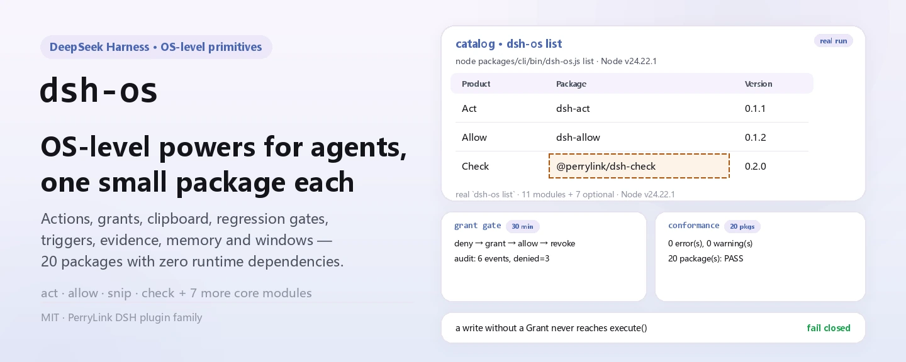
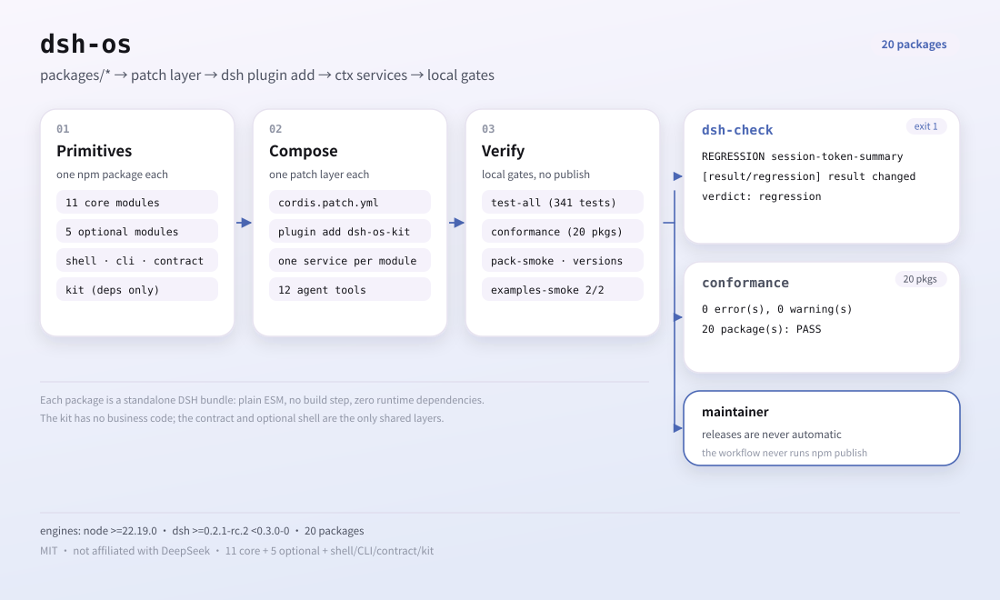
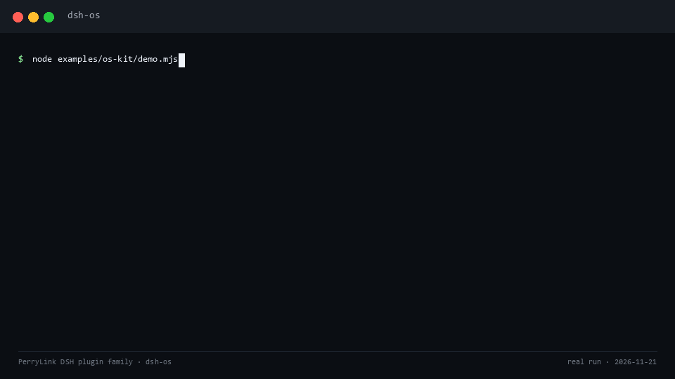

<div align="center">

<picture>
  <source media="(prefers-color-scheme: dark)" srcset="docs/assets/dsh-os-hero-en-dark.webp">
  
</picture>

# dsh-os

**Primitivas de nível de SO para o DeepSeek Harness — vinte pacotes pequenos que permanecem independentes.**

*11 módulos centrais + 5 opcionais + um contrato, um shell React, uma CLI de catálogo e um kit de apenas dependências; um serviço Host por módulo, zero dependências em tempo de execução, e uma escrita que nunca roda sem um Grant humano.*

[English](README.md) · [简体中文](README-zh.md) · [Español](README-es.md) · [Português](README-pt.md) · [हिन्दी](README-hi.md)

[](LICENSE)
[]()

</div>

---

Uma família de **primitivas de nível de SO para o DeepSeek Harness**: 11 módulos
centrais (Act, Allow, Snip, Check, Nest, Trigger, Seek, Trace, Stage, Ring, Root), 5
módulos opcionais (Help, Context, Cost, Backup, Notify), mais um contrato
delgado, um shell de UI opcional, uma CLI de catálogo e um kit de apenas
dependências.

Os módulos permanecem pequenos e independentes: um serviço Host, ≤6
ferramentas de agente, zero dependências em tempo de execução, semver
independente, sem importações entre módulos. O contrato
(`@perrylink/dsh-os-contract`) e o shell opcional são as únicas camadas
compartilhadas; o kit não contém código de negócio.

> **Sem afiliação com a DeepSeek.** DeepSeek e DeepSeek Harness são marcas de
> seus respectivos proprietários. Estes são pacotes comunitários
> independentes, publicados sob MIT.

[](examples/os-kit/README.md)

**Executável em 10 minutos:** [`examples/os-kit`](examples/os-kit/README.md)
tem duas demos sem dependências — Allow + Act + Snip (negar → Grant de 30
minutos → permitir → revogar → negar) e a porta de regressão do Check.
`node examples/os-kit/demo.mjs` só precisa de Node 22+; nada é instalado nem
publicado.

**Documentação:** [Início rápido](docs/quickstart.md) ·
[Plano de validação](docs/validation/PLAN.md) ·
[Smoke de 0.2.0](docs/validation/SMOKE.md) ·
[Receitas](docs/recipes/) (porta de CI, escritas de agentes, área de transferência) ·
[Solução de problemas](docs/troubleshooting.md).

## Pacotes

| Produto | Pacote | Status | Design |
|---|---|---|---|
| **Act** | `dsh-act` | 0.1.1 MVP | [design](docs/design/01-act.md) |
| **Allow** | `dsh-allow` | 0.1.2 MVP (endurecimento de segurança) | [design](docs/design/02-allow.md) |
| **Snip** | `dsh-snip` | 0.2.0 (captura Win/mac/Linux) | [design](docs/design/03-snip.md) |
| **Check** | `@perrylink/dsh-check` | 0.2.0 (runner headless + diff) | [design](docs/design/04-check.md) |
| **Nest** | `dsh-nest` | 0.1.0 MVP | [design](docs/design/05-nest.md) |
| **Trigger** | `dsh-trigger` | 0.2.0 (fontes agent/fs/webhook) | [design](docs/design/06-trigger.md) |
| **Seek** | `dsh-seek` | 0.2.0 (provedores locator + memento) | [design](docs/design/07-seek.md) |
| **Trace** | `@perrylink/dsh-trace` | 0.2.0 (adaptador memento) | [design](docs/design/08-trace.md) |
| **Stage** | `dsh-stage` | 0.2.0 (adaptadores macOS/Windows) | [design](docs/design/09-stage.md) |
| **Ring** | `dsh-ring` | 0.2.0 (webhook/ntfy/console) | [design](docs/design/10-ring.md) |
| **Root** | `@perrylink/dsh-root` | 0.1.2 MVP | [design](docs/design/11-root.md) |
| **Help** | `dsh-help` | 0.1.0 opcional | diagnóstico de instalação / primeira execução |
| **Context** | `@perrylink/dsh-context` | 0.1.0 opcional | protocolo de provedor de contexto |
| **Cost** | `@perrylink/dsh-cost` | 0.1.0 opcional | adaptador para `dsh-cost-meter` |
| **Backup** | `@perrylink/dsh-backup` | 0.1.0 opcional | manifesto de snapshot / plano de restauração |
| **Notify** | `@perrylink/dsh-notify` | 0.1.0 opcional | registro de canais / roteador de atenção |
| **Shell** | `@perrylink/dsh-os-shell` | 0.2.0 opcional | cliente React (abas Act/Snip/Check) |
| **CLI** | `@perrylink/dsh-os-cli` | 0.1.0 ferramenta | `dsh-os list/doctor/install` |
| **Contract** | `@perrylink/dsh-os-contract` | 0.1.0 biblioteca | constantes, refs, validação de manifest/tool |
| **Kit** | `dsh-os-kit` | 0.2.0 meta bundle | instala Act + Allow + Snip + Check 0.2.0 |

`Check`, `Trace`, `Root`, `Context`, `Cost`, `Backup`, `Notify`, `Shell`, `CLI`
e `Contract` usam o scope `@perrylink/` onde as regras de similaridade de nomes
do npm exigem; os nomes de produto permanecem sem scope.

<picture>
  <source media="(prefers-color-scheme: dark)" srcset="docs/assets/dsh-os-flow-v5-dark.svg">
  
</picture>

*Estrutura: pacote → camada de patch → serviço → porta; `dsh-os-kit` instala Act + Allow + Snip + Check com um único comando, e as mesmas portas rodam na CI e localmente. Rótulos de token dentro do diagrama são os nomes reais de pacotes, serviços e comandos, então a mesma imagem serve aos cinco idiomas.*

## Instalação

```sh
# one-shot: the four core modules
dsh plugin --profile web add dsh-os-kit

# or individually
dsh plugin --profile web add dsh-act
dsh plugin --profile web add dsh-allow
dsh plugin --profile web add dsh-snip
dsh plugin --profile web add dsh-nest
dsh plugin --profile web add dsh-trigger
dsh plugin --profile web add dsh-seek
dsh plugin --profile web add dsh-stage
dsh plugin --profile web add dsh-ring
dsh plugin --profile web add @perrylink/dsh-check
dsh plugin --profile web add @perrylink/dsh-root
dsh plugin --profile web add @perrylink/dsh-trace

# optional small modules
dsh plugin --profile web add dsh-help
dsh plugin --profile web add @perrylink/dsh-context
dsh plugin --profile web add @perrylink/dsh-cost
dsh plugin --profile web add @perrylink/dsh-backup
dsh plugin --profile web add @perrylink/dsh-notify
dsh plugin --profile web add @perrylink/dsh-os-shell

# catalog CLI (no network, prints install plans)
npm i -g @perrylink/dsh-os-cli
dsh-os list
dsh-os doctor
```

## Estrutura do repositório

```
packages/    one npm package per primitive
examples/    dependency-free runnable demos
docs/        design notes and the implementation contract
scripts/     scaffold, test and publish helpers
```

## Status

Vinte pacotes publicam um MVP 0.1.x/0.2.x: serviços, ferramentas de agente,
testes e um manifesto de bundle (bibliotecas/CLI quando aplicável). 0.2.0
adiciona os primeiros adaptadores reais: runner headless do Check, captura de
área de transferência do Snip, fontes agent/fs/webhook do Trigger, provedores
locator/memento do Seek, janelas macOS/Windows do Stage, adaptador memento do
Trace, canais webhook/ntfy/console do Ring e o shell React.
`node scripts/test-all.mjs` roda 21 suítes; `npm run verify` roda a verificação
completa de quatro portas de release.

## Desenvolvimento



*Animado: o stdout real de `node examples/os-kit/demo.mjs`, `bash examples/os-kit/check-demo/run-check-demo.sh` e `node scripts/conformance.mjs` em 2026-11-21 (linhas selecionadas; os ids de Grant e os handles `clipboard://` mudam a cada execução). Nada é instalado e a rede não é usada.*

```sh
node scripts/scaffold.mjs
node scripts/test-all.mjs
node scripts/publish.mjs act allow   # requires NPM_TOKEN
```

## CI e release

A CI (`.github/workflows/ci.yml`) roda em uma matriz Node 22 + 24 com o cache
do npm habilitado, e executa quatro portas em ordem:

```sh
node scripts/test-all.mjs
node scripts/conformance.mjs
node scripts/pack-smoke.mjs
node scripts/check-versions.mjs
```

- `pack-smoke` roda `npm pack --dry-run --json` para cada `packages/*` e falha
  se o tarball não tiver `package.json`, `index.js`, `cordis.patch.yml`,
  `README.md` ou `LICENSE`.
- `check-versions` falha com um `version` inválido, um range `engines.dsh`
  sem limite superior, um `publishConfig.registry` que não seja npmjs, ou
  `dependencies` não vazio.

A mesma sequência, incluindo os testes dos pacotes, roda localmente como
`npm run verify`.

Releases **nunca são publicados automaticamente**.
`.github/workflows/release.yml` é somente `workflow_dispatch`: recebe uma
entrada `package` separada por vírgulas (nomes de diretório como `act,allow`
ou nomes npm como `dsh-act`), roda as mesmas portas no Node 24, depois faz
`npm pack` apenas dos pacotes selecionados e envia os tarballs como artefato
de build. Publicar é um passo manual do mantenedor: exige o segredo de
repositório `NPM_TOKEN` (um token granular do npm autorizado a publicar
`dsh-*` e `@perrylink/*`), um ambiente protegido por aprovação, e um
`npm publish` explícito dos tarballs revisados. O workflow nunca executa
`npm publish`.

## Comunidade, RFCs e feedback

- **Notas de lançamento e suporte:** [docs/community/launch.md](docs/community/launch.md)
  — o que funciona hoje, o que ainda é 0.3.0, e os rascunhos do post oficial e
  do envio a diretórios.
- **RFCs upstream (sugestões, não requisitos):**
  [`ctx.actions`](docs/rfcs/ctx-actions.md),
  [`ctx.grant`](docs/rfcs/ctx-grant.md),
  [`ctx.triggers`](docs/rfcs/ctx-triggers.md).
- **Telemetria:** [docs/telemetry.md](docs/telemetry.md) — desligada por
  padrão; a 0.1.x não inclui código de telemetria nem de rede.
- **Contribuir:** [CONTRIBUTING.md](CONTRIBUTING.md),
  [templates de issue](.github/ISSUE_TEMPLATE/) e o
  [template de pull request](.github/PULL_REQUEST_TEMPLATE.md).
- **Sem afiliação com a DeepSeek.** DeepSeek e DeepSeek Harness são marcas de
  seus respectivos proprietários.

## Licença

MIT.
