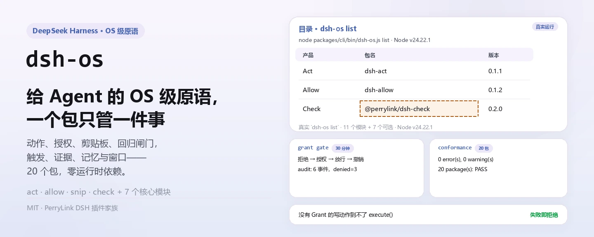
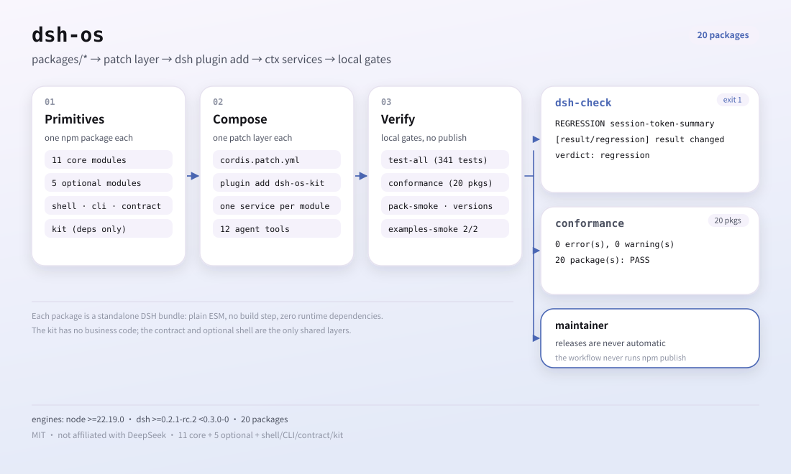
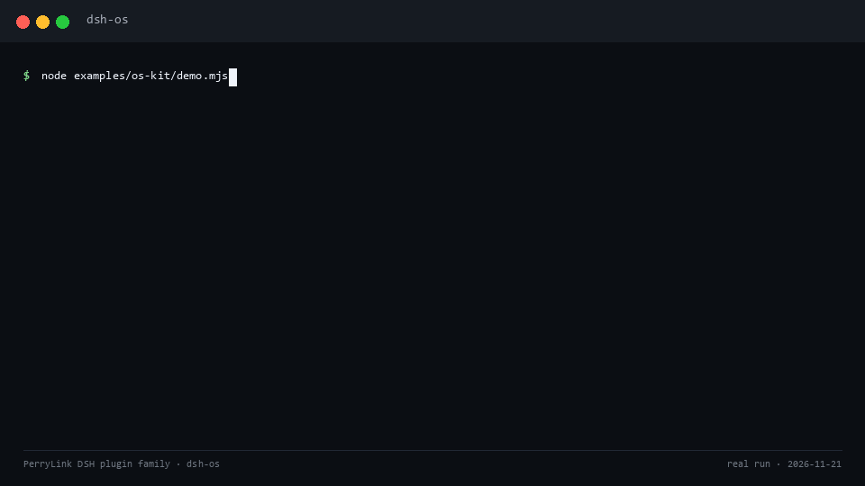

<div align="center">

<picture>
  <source media="(prefers-color-scheme: dark)" srcset="docs/assets/dsh-os-hero-zh-dark.webp">
  
</picture>

# dsh-os

**给 DeepSeek Harness 的 OS 级原语——二十个保持独立的小包。**

*11 个核心模块 + 5 个可选模块，外加契约、React 外壳、目录 CLI 与只含依赖的 kit；每个模块一个 Host 服务、零运行时依赖，没有人类签发的 Grant，写动作永不放行。*

[English](README.md) · [简体中文](README-zh.md) · [Español](README-es.md) · [Português](README-pt.md) · [हिन्दी](README-hi.md)

[](LICENSE)
[]()

</div>

---

一套面向 **DeepSeek Harness 的 OS 级原语**：11 个核心模块
（Act、Allow、Snip、Check、Nest、Trigger、Seek、Trace、Stage、Ring、Root），5
个可选模块（Help、Context、Cost、Backup、Notify），外加一层薄契约、
一个可选 UI 外壳、一个目录 CLI 与一个只含依赖的 kit。

这些模块保持小而独立：一个 Host 服务、≤6 个 agent 工具、
零运行时依赖、独立 semver、无跨模块导入。
契约（`@perrylink/dsh-os-contract`）与可选外壳是唯一的共享层；
kit 不含业务代码。

> **与 DeepSeek 无隶属关系。** DeepSeek 与 DeepSeek Harness 是
> 其各自所有者的商标。这些是独立的社区包，以 MIT 发布。

[](examples/os-kit/README.md)

**10 分钟可跑：** [`examples/os-kit`](examples/os-kit/README.md) 有两个零依赖
演示——Allow + Act + Snip（拒绝 → 30 分钟 Grant → 放行 → 撤销 → 拒绝）
与 Check 回归闸门。`node examples/os-kit/demo.mjs` 只需要 Node 22+；
不安装、不发布任何东西。

**文档：** [快速上手](docs/quickstart.md) ·
[验证计划](docs/validation/PLAN.md) ·
[0.2.0 冒烟](docs/validation/SMOKE.md) ·
[配方](docs/recipes/)（CI 闸门、agent 写入、剪贴板） ·
[排障](docs/troubleshooting.md)。

## 包清单

| 产品 | 包名 | 状态 | 设计 |
|---|---|---|---|
| **Act** | `dsh-act` | 0.1.1 MVP | [设计](docs/design/01-act.md) |
| **Allow** | `dsh-allow` | 0.1.2 MVP（安全加固） | [设计](docs/design/02-allow.md) |
| **Snip** | `dsh-snip` | 0.2.0（Win/mac/Linux 截图） | [设计](docs/design/03-snip.md) |
| **Check** | `@perrylink/dsh-check` | 0.2.0（无头 runner + diff） | [设计](docs/design/04-check.md) |
| **Nest** | `dsh-nest` | 0.1.0 MVP | [设计](docs/design/05-nest.md) |
| **Trigger** | `dsh-trigger` | 0.2.0（agent/fs/webhook 事件源） | [设计](docs/design/06-trigger.md) |
| **Seek** | `dsh-seek` | 0.2.0（locator + memento 提供方） | [设计](docs/design/07-seek.md) |
| **Trace** | `@perrylink/dsh-trace` | 0.2.0（memento 适配器） | [设计](docs/design/08-trace.md) |
| **Stage** | `dsh-stage` | 0.2.0（macOS/Windows 适配器） | [设计](docs/design/09-stage.md) |
| **Ring** | `dsh-ring` | 0.2.0（webhook/ntfy/console） | [设计](docs/design/10-ring.md) |
| **Root** | `@perrylink/dsh-root` | 0.1.2 MVP | [设计](docs/design/11-root.md) |
| **Help** | `dsh-help` | 0.1.0 可选 | 安装诊断 / 首次运行 |
| **Context** | `@perrylink/dsh-context` | 0.1.0 可选 | 上下文提供方协议 |
| **Cost** | `@perrylink/dsh-cost` | 0.1.0 可选 | `dsh-cost-meter` 适配器 |
| **Backup** | `@perrylink/dsh-backup` | 0.1.0 可选 | 快照清单 / 恢复计划 |
| **Notify** | `@perrylink/dsh-notify` | 0.1.0 可选 | 通道注册表 / 注意力路由 |
| **Shell** | `@perrylink/dsh-os-shell` | 0.2.0 可选 | React 客户端（Act/Snip/Check 标签页） |
| **CLI** | `@perrylink/dsh-os-cli` | 0.1.0 工具 | `dsh-os list/doctor/install` |
| **Contract** | `@perrylink/dsh-os-contract` | 0.1.0 库 | 常量、引用、manifest/tool 校验 |
| **Kit** | `dsh-os-kit` | 0.2.0 元 bundle | 安装 Act + Allow + Snip + Check 0.2.0 |

`Check`、`Trace`、`Root`、`Context`、`Cost`、`Backup`、`Notify`、`Shell`、`CLI`
与 `Contract` 在 npm 的名称相似性规则要求时使用 `@perrylink/` 作用域；
产品名本身保持裸名。

<picture>
  <source media="(prefers-color-scheme: dark)" srcset="docs/assets/dsh-os-flow-v5-dark.svg">
  
</picture>

*结构：包 → 补丁层 → 服务 → 门禁；`dsh-os-kit` 一条命令装好 Act + Allow + Snip + Check，同一套门禁在 CI 和本地都会跑。图内只有真实的包名、服务名与命令名，五语共用同一张结构图。*

## 安装

```sh
# one-shot: the four core modules
dsh plugin --profile web add dsh-os-kit

# or individually
dsh plugin --profile web add dsh-act
dsh plugin --profile web add dsh-allow
dsh plugin --profile web add dsh-snip
dsh plugin --profile web add dsh-nest
dsh plugin --profile web add dsh-trigger
dsh plugin --profile web add dsh-seek
dsh plugin --profile web add dsh-stage
dsh plugin --profile web add dsh-ring
dsh plugin --profile web add @perrylink/dsh-check
dsh plugin --profile web add @perrylink/dsh-root
dsh plugin --profile web add @perrylink/dsh-trace

# optional small modules
dsh plugin --profile web add dsh-help
dsh plugin --profile web add @perrylink/dsh-context
dsh plugin --profile web add @perrylink/dsh-cost
dsh plugin --profile web add @perrylink/dsh-backup
dsh plugin --profile web add @perrylink/dsh-notify
dsh plugin --profile web add @perrylink/dsh-os-shell

# catalog CLI (no network, prints install plans)
npm i -g @perrylink/dsh-os-cli
dsh-os list
dsh-os doctor
```

## 仓库结构

```
packages/    one npm package per primitive
examples/    dependency-free runnable demos
docs/        design notes and the implementation contract
scripts/     scaffold, test and publish helpers
```

## 状态

二十个包都发布了 0.1.x/0.2.x 的 MVP：服务、agent 工具、测试与 bundle
manifest（适用处含库/CLI）。0.2.0 加入第一批真实适配器：
Check 无头 runner、Snip 剪贴板采集、Trigger agent/fs/webhook 事件源、
Seek locator/memento 提供方、Stage macOS/Windows 窗口、Trace memento
适配器、Ring webhook/ntfy/console 通道与 React 外壳。
`node scripts/test-all.mjs` 跑 21 个套件；`npm run verify` 跑完整
四道发布门禁。

## 开发



*动图是 2026-11-21 真实跑出的 stdout：`node examples/os-kit/demo.mjs`、`bash examples/os-kit/check-demo/run-check-demo.sh` 与 `node scripts/conformance.mjs`（节选行；grant id 与 `clipboard://` 句柄每次运行都不同）。不需要安装任何东西，也不联网。*

```sh
node scripts/scaffold.mjs
node scripts/test-all.mjs
node scripts/publish.mjs act allow   # requires NPM_TOKEN
```

## CI 与发布

CI（`.github/workflows/ci.yml`）在 Node 22 + 24 矩阵上运行，启用 npm 缓存，
并按顺序执行四道门禁：

```sh
node scripts/test-all.mjs
node scripts/conformance.mjs
node scripts/pack-smoke.mjs
node scripts/check-versions.mjs
```

- `pack-smoke` 对每个 `packages/*` 运行 `npm pack --dry-run --json`，
  tarball 缺少 `package.json`、`index.js`、`cordis.patch.yml`、
  `README.md` 或 `LICENSE` 即失败。
- `check-versions` 遇到非法 `version`、没有上界的 `engines.dsh` 范围、
  非 npmjs 的 `publishConfig.registry`，或非空 `dependencies` 即失败。

同一序列（含包测试）在本地由 `npm run verify` 运行。

发布**永不自动进行**。`.github/workflows/release.yml` 只支持
`workflow_dispatch`：它接收逗号分隔的 `package` 输入
（目录名如 `act,allow`，或 npm 名如 `dsh-act`），在 Node 24 上跑同一套门禁，
然后只 `npm pack` 选中的包，并把 tarball 作为构建产物上传。发布是维护者的
手动步骤：需要 `NPM_TOKEN` 仓库密钥（一个允许发布 `dsh-*` 与 `@perrylink/*`
的细粒度 npm token）、受审批保护的环境，以及对已审阅 tarball 的显式
`npm publish`。工作流本身从不运行 `npm publish`。

## 社区、RFC 与反馈

- **发布与支持说明：** [docs/community/launch.md](docs/community/launch.md)
  —— 今天可用的部分、仍属 0.3.0 的部分，以及官方帖子 / 目录提交草稿。
- **上游 RFC（建议，不是要求）：**
  [`ctx.actions`](docs/rfcs/ctx-actions.md),
  [`ctx.grant`](docs/rfcs/ctx-grant.md),
  [`ctx.triggers`](docs/rfcs/ctx-triggers.md)。
- **遥测：** [docs/telemetry.md](docs/telemetry.md) —— 默认关闭；0.1.x 不携带
  任何遥测或网络代码。
- **贡献：** [CONTRIBUTING.md](CONTRIBUTING.md)、
  [issue 模板](.github/ISSUE_TEMPLATE/) 与
  [pull request 模板](.github/PULL_REQUEST_TEMPLATE.md)。
- **与 DeepSeek 无隶属关系。** DeepSeek 与 DeepSeek Harness 是
  其各自所有者的商标。

## 许可证

MIT。
