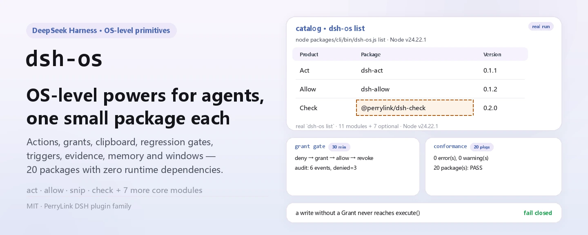
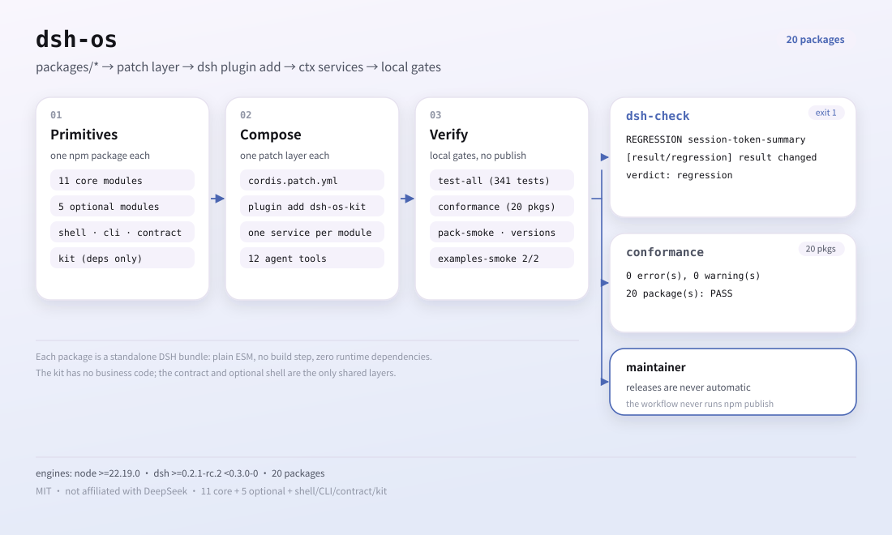
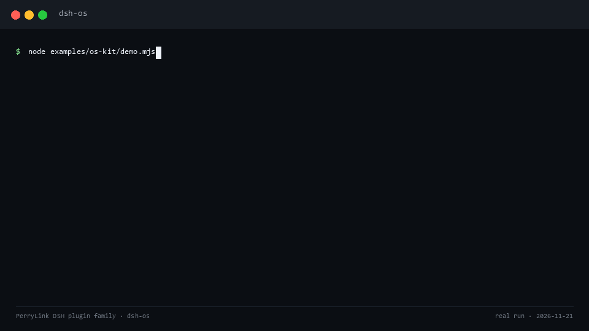

<div align="center">

<picture>
  <source media="(prefers-color-scheme: dark)" srcset="docs/assets/dsh-os-hero-en-dark.webp">
  
</picture>

# dsh-os

**OS-level primitives for DeepSeek Harness — twenty small packages that stay independent.**

*11 core modules + 5 optional + a contract, a React shell, a catalog CLI and a dependency-only kit; one Host service per module, zero runtime dependencies, and a write that never runs without a human Grant.*

[简体中文](README-zh.md) · [Español](README-es.md) · [Português](README-pt.md) · [हिन्दी](README-hi.md)

[](LICENSE)
[]()

</div>

---

## Packages

| Product | Package | Status | Design |
|---|---|---|---|
| **Act** | `dsh-act` | 0.3.0 (real fs actions) | [design](docs/design/01-act.md) |
| **Allow** | `dsh-allow` | 0.3.0 (request/approve) | [design](docs/design/02-allow.md) |
| **Snip** | `dsh-snip` | 0.2.0 (Win/mac/Linux capture) | [design](docs/design/03-snip.md) |
| **Check** | `@perrylink/dsh-check` | 0.2.0 (headless runner + diff) | [design](docs/design/04-check.md) |
| **Nest** | `dsh-nest` | 0.1.0 MVP | [design](docs/design/05-nest.md) |
| **Trigger** | `dsh-trigger` | 0.2.0 (agent/fs/webhook sources) | [design](docs/design/06-trigger.md) |
| **Seek** | `dsh-seek` | 0.2.0 (locator + memento providers) | [design](docs/design/07-seek.md) |
| **Trace** | `@perrylink/dsh-trace` | 0.2.0 (memento adapter) | [design](docs/design/08-trace.md) |
| **Stage** | `dsh-stage` | 0.2.0 (macOS/Windows adapters) | [design](docs/design/09-stage.md) |
| **Ring** | `dsh-ring` | 0.2.0 (webhook/ntfy/console) | [design](docs/design/10-ring.md) |
| **Root** | `@perrylink/dsh-root` | 0.1.2 MVP | [design](docs/design/11-root.md) |
| **Help** | `dsh-help` | 0.1.0 optional | install doctor / first run |
| **Context** | `@perrylink/dsh-context` | 0.1.0 optional | context provider protocol |
| **Cost** | `@perrylink/dsh-cost` | 0.1.0 optional | adapter for `dsh-cost-meter` |
| **Backup** | `@perrylink/dsh-backup` | 0.1.0 optional | snapshot manifest / restore plan |
| **Notify** | `@perrylink/dsh-notify` | 0.1.0 optional | channel registry / attention router |
| **Shell** | `@perrylink/dsh-os-shell` | 0.3.0 optional | approvals + activity tabs |
| **CLI** | `@perrylink/dsh-os-cli` | 0.2.0 tool | `dsh-os list/doctor/install/approvals` |
| **Contract** | `@perrylink/dsh-os-contract` | 0.2.0 library | result/error/handle protocols |
| **Kit** | `dsh-os-kit` | 0.3.0 meta bundle | installs Act/Allow 0.3 + Snip/Check 0.2 |
| **Kernel** | `@perrylink/dsh-os-kernel` | 0.1.0 core | capability registry + 5 `os_*` verbs |
| **MCP** | `@perrylink/dsh-os-mcp` | 0.1.0 tool | read-only MCP server prototype |

`Check`, `Trace`, `Root`, `Context`, `Cost`, `Backup`, `Notify`, `Shell`, `CLI`
and `Contract` use the `@perrylink/` scope where npm's name-similarity rules
require it; the product names stay bare.


<picture>
  <source media="(prefers-color-scheme: dark)" srcset="docs/assets/dsh-os-flow-v5-dark.svg">
  
</picture>

*Structure: package → patch layer → service → gate; `dsh-os-kit` installs Act + Allow + Snip + Check in one command, and the same gates run in CI and locally. The token labels inside the diagram are the real package, service and command names, so the same picture serves all five languages.*

## Install

```sh
# one-shot: the four core modules
dsh plugin --profile web add dsh-os-kit

# or individually
dsh plugin --profile web add dsh-act
dsh plugin --profile web add dsh-allow
dsh plugin --profile web add dsh-snip
dsh plugin --profile web add dsh-nest
dsh plugin --profile web add dsh-trigger
dsh plugin --profile web add dsh-seek
dsh plugin --profile web add dsh-stage
dsh plugin --profile web add dsh-ring
dsh plugin --profile web add @perrylink/dsh-check
dsh plugin --profile web add @perrylink/dsh-root
dsh plugin --profile web add @perrylink/dsh-trace

# AI gateway kernel (capability registry + os_* verbs)
dsh plugin --profile web add @perrylink/dsh-os-kernel

# optional small modules
dsh plugin --profile web add dsh-help
dsh plugin --profile web add @perrylink/dsh-context
dsh plugin --profile web add @perrylink/dsh-cost
dsh plugin --profile web add @perrylink/dsh-backup
dsh plugin --profile web add @perrylink/dsh-notify
dsh plugin --profile web add @perrylink/dsh-os-shell

# catalog CLI (no network, prints install plans)
npm i -g @perrylink/dsh-os-cli
dsh-os list
dsh-os doctor
dsh-os approvals list --state ~/.dsh/allow.json

# read-only MCP server prototype
npm i -g @perrylink/dsh-os-mcp
dsh-os-mcp --help
```

## Repository layout

```
packages/    one npm package per primitive
examples/    dependency-free runnable demos
docs/        design notes and the implementation contract
scripts/     scaffold, test and publish helpers
```

## Status

Twenty-two packages ship a 0.1.x/0.2.x/0.3.x MVP: services, agent tools, tests and a bundle
manifest (libraries/CLI where applicable). 0.2.0 added real adapters; 0.3.0 adds the kernel + permission request flow + Act fs actions + human oversight:
Check headless runner, Snip clipboard capture, Trigger agent/fs/webhook sources,
Seek locator/memento providers, Stage macOS/Windows windows, Trace memento
adapter, Ring webhook/ntfy/console channels and the React shell.
`node scripts/test-all.mjs` runs 21 suites; `npm run verify` runs the full
four-gate release check.

## Development



*Animated: the real stdout of `node examples/os-kit/demo.mjs`, `bash examples/os-kit/check-demo/run-check-demo.sh` and `node scripts/conformance.mjs` on 2026-11-21 (selected lines; Grant ids and `clipboard://` handles differ per run). Nothing is installed and no network is used.*


```sh
node scripts/scaffold.mjs
node scripts/test-all.mjs
node scripts/publish.mjs act allow   # requires NPM_TOKEN
```

## CI and release

CI (`.github/workflows/ci.yml`) runs on a Node 22 + 24 matrix with the npm cache
enabled, and executes four gates in order:

```sh
node scripts/test-all.mjs
node scripts/conformance.mjs
node scripts/pack-smoke.mjs
node scripts/check-versions.mjs
```

- `pack-smoke` runs `npm pack --dry-run --json` for every `packages/*` and
  fails if the tarball lacks `package.json`, `index.js`, `cordis.patch.yml`,
  `README.md` or `LICENSE`.
- `check-versions` fails on an invalid `version`, an `engines.dsh` range
  without an upper bound, a `publishConfig.registry` that is not npmjs, or a
  non-empty `dependencies`.

The same sequence, including the package tests, runs locally as
`npm run verify`.

Releases are **never published automatically**. `.github/workflows/release.yml`
is `workflow_dispatch`-only: it takes a comma-separated `package` input
(directory names such as `act,allow` or npm names such as `dsh-act`), runs the
same gates on Node 24, then `npm pack`s only the selected packages and uploads
the tarballs as a build artifact. Publishing is a manual maintainer step: it
needs the `NPM_TOKEN` repository secret (a granular npm token allowed to
publish `dsh-*` and `@perrylink/*`), an approval-protected environment, and an
explicit `npm publish` of the reviewed tarballs. The workflow never runs
`npm publish`.

## Community, RFCs and feedback

- **Launch and support notes:** [docs/community/launch.md](docs/community/launch.md)
  — what works today, what is still 0.4.0, and the official post / directory
  submission drafts.
- **Upstream RFCs (suggestions, not requirements):**
  [`ctx.actions`](docs/rfcs/ctx-actions.md),
  [`ctx.grant`](docs/rfcs/ctx-grant.md),
  [`ctx.triggers`](docs/rfcs/ctx-triggers.md).
- **Telemetry:** [docs/telemetry.md](docs/telemetry.md) — off by default; no
  telemetry or network code ships in 0.1.x.
- **Contributing:** [CONTRIBUTING.md](CONTRIBUTING.md),
  [issue templates](.github/ISSUE_TEMPLATE/) and the
  [pull request template](.github/PULL_REQUEST_TEMPLATE.md).
- **Not affiliated with DeepSeek.** DeepSeek and DeepSeek Harness are
  trademarks of their respective owners.

## License

MIT.
